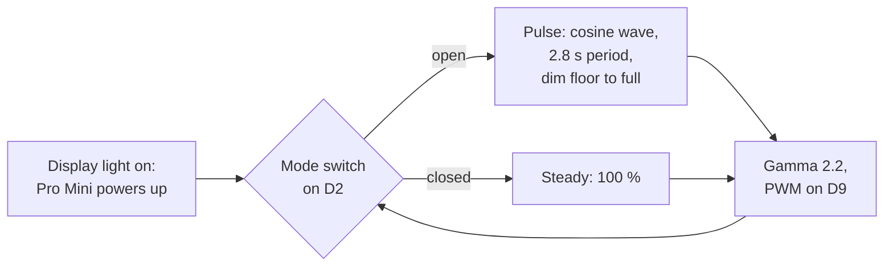

# Fiido C21

Mods for the Fiido C21 e-bike:

| Mod | What it is | Where |
|---|---|---|
| [Tail light](#tail-light) | A salvaged red LED strip, run by an Arduino Pro Mini off the display's light output | `back-lights/` |
| Fiido Ride app | iOS app: riding HUD, Auto-Eco, auto power, ride logging over Bluetooth | [momonala/fiido-ride](https://github.com/momonala/fiido-ride) |

## Tail light

The display's light output (~40 V) goes through a 1 A fuse and an LM2596HV buck down to 5 V. The Pro Mini drives the strip through an IRL3103 MOSFET on D9, with a 10 Ω 2 W resistor setting the current to about 300 mA. Because it hangs off the light output, the tail light follows the front light and draws nothing when the bike is parked.

A toggle switch from D2 to GND picks the mode. Open: slow pulses from dim to full, 2.8 s each, never fully off. Closed: steady full brightness.



The sketch runs one loop, with no saved state:



### Flashing

Over the FTDI adapter (5 V / 16 MHz Pro Mini; for a 3.3 V / 8 MHz board use `cpu=8MHzatmega328`):

```bash
brew install arduino-cli
arduino-cli core install arduino:avr
cd back-lights
arduino-cli compile --fqbn arduino:avr:pro:cpu=16MHzatmega328 taillight
arduino-cli board list   # find the USB serial adapter's port
arduino-cli upload --fqbn arduino:avr:pro:cpu=16MHzatmega328 -p <port> taillight
```

Press reset on the Pro Mini when "Uploading" appears. The adapter doesn't reset the board itself, so without the press the upload fails with `not in sync: resp=0x00`.

### Files

- `back-lights/taillight/taillight.ino`: the sketch. Pulse speed is `PULSE_MS`.
- `back-lights/led-strip-taillight.html`: build guide with the full parts list and gotchas.
- `back-lights/img/`: photos of the strip and the wiring diagram (`wiring.svg`, also in the build guide).
